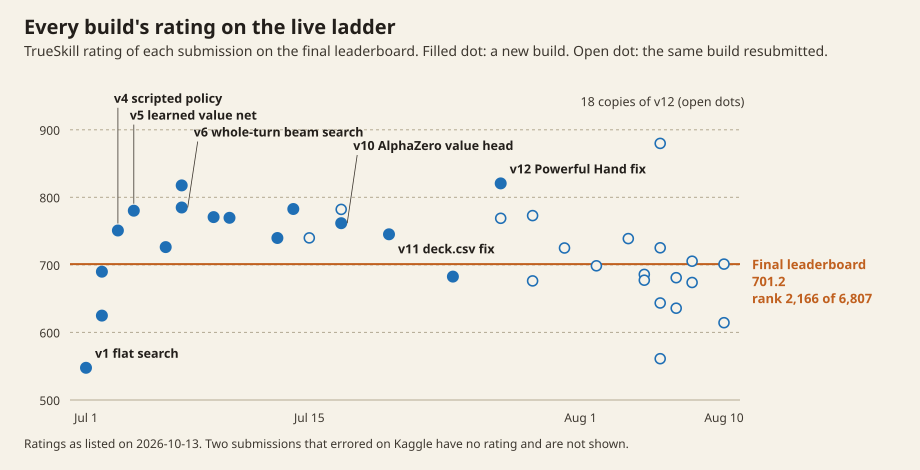
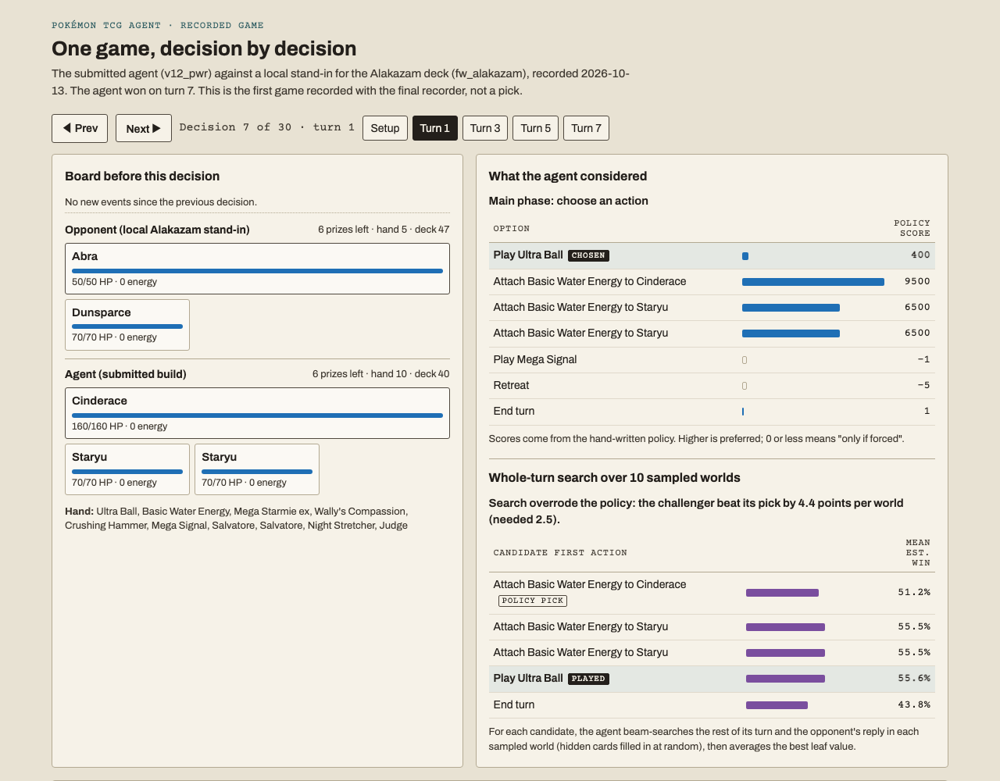
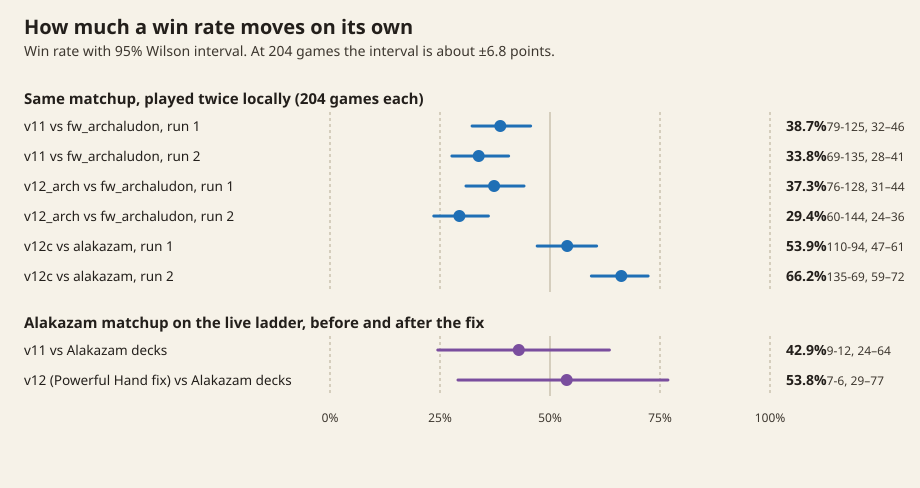

# Pokémon TCG AI Battle Challenge agent

An agent for Kaggle's [PTCG AI Battle Challenge Simulation](https://www.kaggle.com/competitions/pokemon-tcg-ai-battle)
(July–August 2026). Bots play the Pokémon Trading Card Game against each other
on a live TrueSkill ladder. The game has hidden information (the opponent's
hand and both decks' order), and every move has a time limit.

**Result:** rank 2,166 of 6,807 teams, rating 701.2, on the public leaderboard
as exported on 13 October 2026. The best rating any of the 38 submissions
reached was 879.8, from one of 18 submissions of the final build.



## Watch it play

[`docs/replay/`](docs/replay/) replays one complete local game turn by turn: the
board before each decision, every option the agent was offered with its policy
score, and, where the search ran, the candidate turns it compared and how each
scored. It is the first game recorded with `tools/record_game.py`, not a pick.

```bash
python3 -m http.server -d docs/replay 8000   # then open http://localhost:8000
```



## How it decides

The submitted agent ([`baselines/v12_pwr/`](baselines/v12_pwr/), identical to the
last build sent to Kaggle) is a scripted policy wrapped in a determinized
whole-turn search, with a learned value function scoring the leaves.

```
observation ──> archetype detection ──> per-matchup config
                        │
                        ▼
        candidate moves from hand-written scorers
        (~30 decision contexts: play / attach / evolve /
        retreat / attack / promote / …)
                        │
                        ▼
        at pivotal decisions: up to 5 candidate first actions,
        each followed by a beam search over the rest of the turn
        (width 4, top-3 expansion), then the opponent's reply,
        in up to 10 sampled worlds for the hidden cards
                        │
                        ▼
        leaf value: 0.6 × AlphaZero value head
                  + 0.4 × squashed handcrafted score
```

1. **Scripted policy.** Per-context card scorers and an attack planner with
   weakness and resistance maths, knock-out and prize-race logic, and
   per-archetype overrides (`main.py`, `deck_configs.py`).
2. **Whole-turn search.** A challenger replaces the policy's pick only if it
   beats it by a fixed margin summed over the sampled worlds. Turning
   single-move search into whole-turn beam search was build v6.
3. **AlphaZero value head.** A 697,602-parameter policy-and-value network
   trained by self-play expert iteration (`agent_az/`, `train/`). Its policy
   head never beat its scripted teacher, but its value head replaced the
   earlier numpy value net at the search leaves from build v10 on. It predicts
   the winner of held-out self-play positions with an AUC of 0.807, and of
   positions from real ladder games with 0.736.

`agent2/` is a later development copy of the same agent. It does not load the
AlphaZero value head. The value-head weights (`az_value_net.pt`, 2.8 MB) are
not committed, so a fresh clone falls back to the numpy value net and prints
a warning.

## What turned out to matter

Most of the gains came from fixing the agent's model of the game, not from
tuning.

- **`deck.csv` was never read.** Until build v11 the agent always played the
  deck from a config constant, so every earlier deck experiment compared
  identical decks (comment in `baselines/v12_pwr/main.py`; v11's submission
  note).
- **An opponent's main attack was modelled as 0 damage.** The card list gives
  Alakazam's *Powerful Hand* a damage of 0; it actually places damage counters
  for each card in the attacker's hand. Build v12 taught the threat model about
  it. On the live ladder, against Alakazam decks, v11 won 9 of 21 games with a
  cached replay (42.9%, 95% interval 24–64%) and v12 won 7 of 13 (53.8%, 29–77%).
  That is the direction I hoped for, but far too few games to call.
- **Local opponents are stand-ins.** The `fw_*` opponents are other decks
  piloted by this agent's own framework, not the real players. The ladder
  replays are the ground truth (`tools/my_episodes.py`).

## How much a win rate moves on its own



The agent is not deterministic, so a 204-game local cell has a 95% interval of
about ±6.8 points at 50%. The same agent against the same opponent scored
53.9% and then 66.2% in two runs (`logs/screen_v12_rest_cells.log`). Differences
under about ten points cannot be resolved at that sample size, and several
changes that looked like improvements were not.

## What didn't work

These are from my notes during the competition; the runs behind them were not
kept, so treat them as reported, not measured here.

- Hand-reasoned fixes to the policy (energy-attachment guards, supporter
  priority, threat-model rewrites) each measured worse in paired testing.
- A wider beam barely changed anything: the per-turn branching factor is too
  small to fill it.
- An imitation-learned policy predicted top players' moves better than the
  scripts but played worse as a candidate generator.
- More self-play rounds left the standalone AlphaZero agent level with its
  scripted teacher.

## Where each number comes from

| Claim | Source |
|---|---|
| Rank 2,166 of 6,807, rating 701.2 | Kaggle public leaderboard export, 13 Oct 2026 (`results/results.json`, `ladder.leaderboard`) |
| Each build's rating; highest 879.8 | Kaggle submissions list (`ladder.builds_first_submission`, `ladder.all_submissions`) |
| Alakazam 9/21 → 7/13 | Kaggle episode lists and cached replays, computed before the replays were deleted (`matchups`) |
| ±6.8 points at 204 games; repeated cells | Tracked logs in `logs/`; every interval recomputed and matching (`local_screens`) |
| *Powerful Hand* listed as 0 damage | Competition card list (not included) |
| v10 beat v8-judge 58% over 400 games (95% interval 53.2–62.8) | v10's submission note only; the game log was not kept |
| Value head: outcome AUC 0.807 on held-out self-play positions, 0.736 on held-out ladder positions | Metrics saved in the submitted checkpoint by `train/train_az2.py` (`value_head`). The best epoch was chosen on the same held-out sets, so both are optimistic. |
| The numpy value net it replaced: about 0.72 | Code comment in `baselines/v12_pwr/main.py` only |

`results/results.json` is written by `tools/site_results.py`; the figures by
`tools/make_figures.py`.

## Layout

| Path | Contents |
|---|---|
| `baselines/v12_pwr/` | The submitted agent |
| `agent2/` | Later development copy of the agent (numpy value net) |
| `agent_az/` | AlphaZero network, PUCT MCTS and self-play agent |
| `train/` | Training scripts for the value and policy nets (data not included) |
| `tools/` | Local leagues, ladder-replay analysis, the game recorder, results and figures |
| `baselines/` | Frozen agent variants used as controls and sparring partners |
| `exp/` | Archived experiments, including ones that were not shipped |
| `logs/`, `runs/` | Kept local evaluation logs |
| `docs/replay/` | Replay viewer and the recorded game |

## Running it

**The competition engine and data are not included, and have been deleted.**
The simulator, the card data and the match replays were licensed for
competition use only: not to be redistributed, and to be deleted when the
competition ended. They were never committed. After the replay in
`docs/replay/` was recorded, every local copy was deleted (13 October 2026):
the package, the engine build, the cached replays, the engine copy in each
agent folder, the submission bundles (which contained the engine), and the
training tensors extracted from replays. Every file of every submitted build,
apart from the engine and the value-head weights, is tracked in this repo
(v1 and v1.1 were recovered from their bundles into `baselines/` first).
To run anything that plays games you need the competition package from
Kaggle: put its `sample_submission/` under `data/` (the code looks for
`data/sample_submission/sample_submission/cg/` and `data/EN_Card_Data.csv`).
Redrawing the figures and viewing the replay need neither.

Requires Python 3.13 and [uv](https://docs.astral.sh/uv/).

```bash
# local head-to-head, here 8 games (checked on 13 Oct 2026: ~25 s on an M-series Mac)
uv run --python 3.13 --with-requirements requirements.txt \
    python tools/league.py baselines/v12_pwr baselines/v6 8

# record one game and export it for the viewer
uv run --python 3.13 --with-requirements requirements.txt \
    python tools/record_game.py baselines/v12_pwr baselines/fw_alakazam recording.json --seed 1
python3 tools/export_demo.py recording.json docs/replay/demo.json

# redraw the figures from results/results.json (no engine needed)
python3 tools/make_figures.py
```

## Licence

My code is under the MIT licence (`LICENSE`). `baselines/multiply/` is a port of
aristophanivan's "MultiPly Beam Search Agent" Kaggle notebook under the Apache
License 2.0 (see its `NOTICE`). A port of a second public notebook, which states
no licence, was used locally as a sparring partner and is not included.
